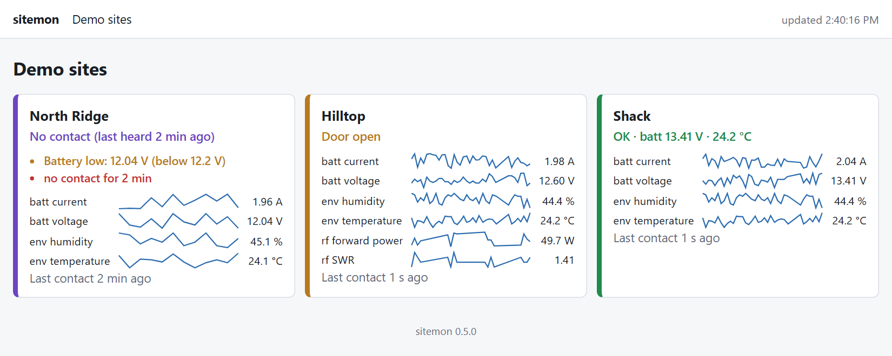
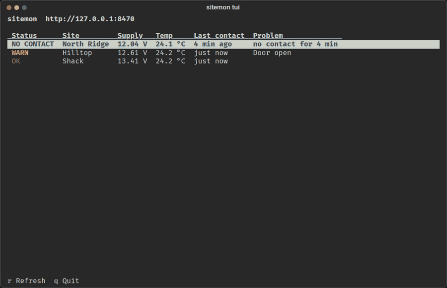
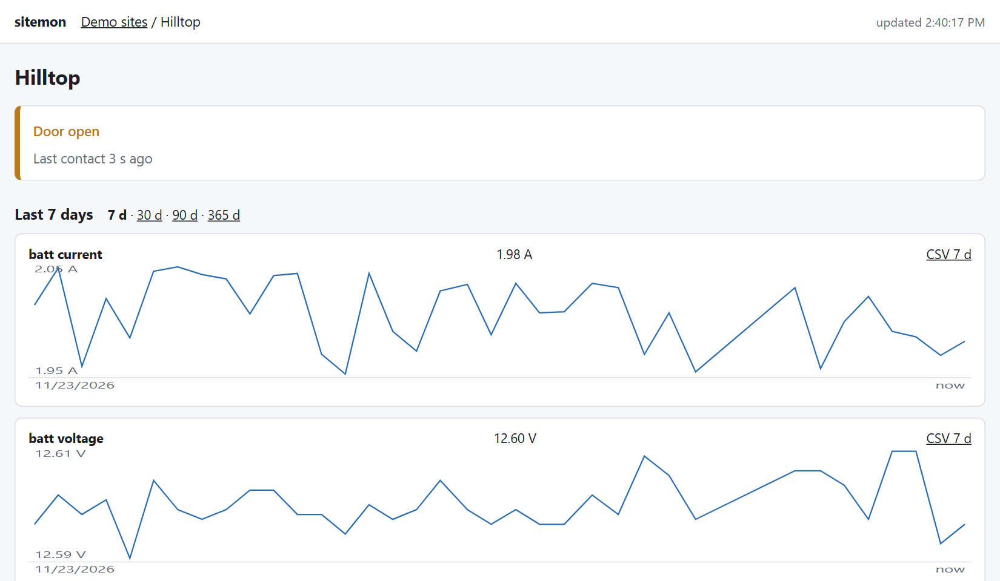

<h1 align="center">sitemon</h1>

<p align="center">
  <b>Find out a repeater site is in trouble before someone keys up and nothing answers.</b>
</p>

<p align="center">
  <a href="https://github.com/Londopy/sitemon/actions/workflows/ci.yml"></a>
  <a href="https://github.com/Londopy/sitemon/releases/latest"></a>
  <a href="https://pypi.org/project/sitemon/"></a>
  <a href="https://pypi.org/project/sitemon/"></a>
  <a href="https://pypistats.org/packages/sitemon"></a>
  <a href="CHANGELOG.md"></a>
  <a href="LICENSE"></a>
  <br>
  <a href="https://github.com/astral-sh/ruff"></a>
  <a href="https://mypy-lang.org/"></a>
  <a href="https://textual.textualize.io/"></a>
  <a href="https://pypi.org/project/sitemon/"></a>
  <a href="#install"></a>
  <a href="https://github.com/Londopy/sitemon/commits/main"></a>
</p>

sitemon is a small agent for the Raspberry Pi at each repeater or AllStar site, plus a hub that
watches all of them. The agent reads the battery, the shack temperature, the door, AllStar and the
local AREDN node. The hub alerts people and shows every site on one page. Readings queue at the
site and catch up when any path comes back, so a flaky link doesn't lose them.

<p align="center">
  <picture>
    <source media="(prefers-color-scheme: dark)" srcset="https://raw.githubusercontent.com/Londopy/sitemon/main/docs/dashboard-dark.png">
    
  </picture>
  <br>
  <sub>The hub dashboard, with the three simulated sites from <code>sitemon demo</code>.</sub>
</p>

## Try it without a Pi

No Pi or radio needed. The demo runs a hub and three simulated sites on your machine:

```console
$ pip install "sitemon[tui]"
$ sitemon demo
Dashboard: http://127.0.0.1:8470  (data in /tmp/sitemon-demo-1a2b; Ctrl+C to stop)
```

Open the dashboard in a browser, or run `sitemon tui --hub http://127.0.0.1:8470` in a second
terminal. Hilltop has its door open, and North Ridge has a low battery and goes quiet after a
minute, so you can watch the silence alarm fire.

## Features

| | |
|---|---|
| 🔋 **Power** | Battery, solar and PSU rails via INA226 (or INA219 for lower voltage). |
| 🌡️ **Environment** | Temperature, humidity and pressure via BME280. |
| 🚪 **Door and water** | Any reed switch or float switch on a GPIO pin. |
| 📻 **AllStar** | Keyed state, linked nodes and uptime over AMI, on localhost only, read-only. |
| 📡 **AREDN** | Node reachability, firmware, links and RF links from the local node. |
| 📶 **RF** | Forward and reflected power and SWR while transmitting, so a failing feedline shows up as a trend. |
| 🔌 **Relays** | Power-cycle a hung radio or node, or switch shack lights, with commands signed by your own key. |
| 📏 **Rules** | Thresholds with hysteresis, slow trends ("battery fell 0.3 V in a week"), state changes, sensor faults, silent sites. |
| 🔔 **Alerts** | One message when something breaks, one when it escalates, one when it's fixed. Discord, ntfy, email or SMS, optionally spoken on the repeater. |
| 📊 **Dashboard** | A tile per site, charts from 7 days to a year, alert and command history, CSV export, a weekly summary. |
| 🖥️ **Terminal dashboard** | The same over SSH with `sitemon tui`, no browser needed. |
| 🏔️ **Built for the hilltop** | I2C error recovery, chips re-initialised after RF-induced resets, systemd watchdog, batched writes to spare the SD card. |

<details>
<summary><b>More on AllStar, relays and spoken alerts</b></summary>

- **AllStar:** the AMI user only needs to query status. Registration status and spoken alerts are
  opt-in, and they need an AMI permission that allows any CLI command (see
  [deploy/README.md](deploy/README.md)).
- **RF:** read from a directional coupler and two AD8307 detectors.
- **Relays:** every relay has a time limit, and a hardware cutoff drops them if the Pi hangs.
- **Weekly summary:** posted to Discord, including which way each battery's nightly low is heading.

</details>

## Terminal dashboard

<p align="center">
  
  <br>
  <sub><code>sitemon tui</code> against the same demo hub.</sub>
</p>

`sitemon tui` lists sites worst first. Enter opens one, `d` changes the chart range and Esc goes
back. With `--key`, pick a relay and press `p`, `o` or `f` to pulse it or switch it on or off.
Each command asks for confirmation first, then waits for the site's answer. It uses your
terminal's own colours, light or dark.

```bash
sitemon tui --hub http://hub.local.mesh:8470
sitemon tui --hub https://sitemon.example.org --key ~/.config/sitemon/operator.key
sitemon tui     # on a site Pi: that agent's queue, hub backlog, sensor faults and readings
```

Point it at the hub itself rather than through Anubis on an internet mirror, which may challenge
it as it would a browser.

<details>
<summary><b>More screenshots</b></summary>
<br>
<p align="center">
  <picture>
    <source media="(prefers-color-scheme: dark)" srcset="https://raw.githubusercontent.com/Londopy/sitemon/main/docs/site-dark.png">
    
  </picture>
  <br>
  <sub>A site page, with a chart and a CSV link per reading.</sub>
</p>
</details>

## Install

On each site's Pi (ASL3 and Raspberry Pi OS bookworm ship Python 3.11):

```bash
python3 -m venv /opt/sitemon
/opt/sitemon/bin/pip install "sitemon[pi,tui]"
```

On the hub (any Linux box on the mesh, or a small VPS):

```bash
python3 -m venv /opt/sitemon
/opt/sitemon/bin/pip install "sitemon[tui]"
```

Drop `tui` if you don't want the terminal dashboard; it only adds
[Textual](https://textual.textualize.io/). [deploy/README.md](deploy/README.md) has the full
walk-through: wiring, the AMI user, systemd units and a read-only root. Public hubs sit behind
[Anubis](https://github.com/TecharoHQ/anubis) to keep AI scrapers off; see `deploy/hub/`.

## Usage

1. On the site, make its signing key and note the public key it prints:

   ```bash
   sitemon keygen --out /etc/sitemon/site.key
   ```

2. Add the site and its public key to the hub config, and point the agent at the hub
   (examples in [deploy/](deploy/)).

3. Check both configs, then start the services:

   ```bash
   sitemon check /etc/sitemon/agent.toml
   systemctl enable --now sitemon-agent
   ```

Each site also serves a small status page on `127.0.0.1:8471` for whoever is standing in the
shack.

## Configuration

| File | Where |
|---|---|
| Agent | `/etc/sitemon/agent.toml` ([example](deploy/agent.example.toml)) |
| Hub | `/etc/sitemon/hub.toml` ([example](deploy/hub.example.toml)) |
| Site key | `/etc/sitemon/site.key` (0600, made by `sitemon keygen`) |

🔒 Secrets never go in the TOML. The AMI password, webhook URLs and SMTP password come from an
environment variable (`*_env`) or a file (`*_file`), so you can paste a config into a bug report
as it is.

<details>
<summary><b>Example rules</b></summary>

```toml
# hub.toml (excerpt)
[[rules]]
name = "Battery low"
metric = "batt.v"          # <sensor name>.<value>
below = 12.2               # warn
critical_below = 11.8
hysteresis = 0.1           # stays open until 12.3 V, so it doesn't flap
hold = "2m"                # must stay low 2 minutes; a key-up sag never alerts
unit = "V"

[[rules]]
name = "Battery falling"
type = "rate"
metric = "batt.v"
window = "7d"              # compare with a week ago...
smooth = "1d"              # ...using daily averages, so the solar cycle cancels out
drop = 0.3
unit = "V"
```

</details>

## How is this different from Allmon3 or a PacketFlux SiteMonitor?

| | Allmon3 / Supermon | PacketFlux / NetGuardian | sitemon |
|---|:---:|:---:|:---:|
| AllStar link and keyed state | ✅ | ❌ | ✅ |
| Site power, temperature, door | ❌ | ✅ | ✅ |
| Every site on one page | ❌ | via your NMS | ✅ |
| Alerts when a site goes silent | ❌ | via your NMS | ✅ |
| Keeps readings through a link outage | ❌ | ❌ | ✅ |
| Cost per site, excluding the Pi | free | $130+ | about $40-80 in parts |

sitemon doesn't replace Allmon3; run both. It reads AMI the same way, read-only.

## What it will not do

- 🎛️ **Replace the repeater controller.** Relays power-cycle equipment and switch accessories.
  They don't key the transmitter or change its settings.
- 🔐 **Encrypt data over the mesh.** Part 97 bars messages encoded to obscure their meaning, so
  everything is signed instead.
- 📐 **Measure RF power precisely.** Forward and reflected power are for trends. It isn't a
  calibrated wattmeter, and its accuracy against one hasn't been measured yet.

<details>
<summary><b>The details: remote control, Part 97 and the mesh</b></summary>

- **Remote control** has to come over a wireline path (internet, cellular) unless you run a
  proper auxiliary station (47 CFR 97.213). sitemon refuses control hubs that may be on the mesh
  (`.mesh` and bare names, 10.x addresses) or on plain HTTP. It never connects to a control hub
  at a 10.x address, whatever its name resolves to, and command polls don't follow redirects. It
  can't see a tunnel or gateway onto the mesh behind some other address, so listing only wireline
  hubs is still up to you.
- **Relay time limit:** every relay switches off about 170 s at most after the command that
  switched it on (the relay loop checks once a second), inside the 3 minutes 97.213 allows after
  a failed control link, unless it's marked `transmitter = false` (shack lights). That limits
  what a command can start; timing each transmission stays the repeater controller's job.
- **Encryption:** 47 CFR 97.113(a)(4) bars messages encoded to obscure their meaning, and the
  common reading is that this rules out encrypting terrestrial amateur traffic (an
  interpretation, not an FCC ruling). Signing lets the hub tell a real reading from a forged one.

</details>

## Status

🧪 Everything is tested in software, against simulated sensors, a fake AMI server and
hand-written AREDN replies. None of it has run at a real site yet. These haven't been checked on
hardware:

- the INA, BME280 and ADS1115 drivers on a real I2C bus
- the relays and the hardware cutoff circuit
- the RF readings against a wattmeter
- spoken alerts through a real ASL3 node
- a real AREDN node's sysinfo

Reports from a first install are welcome as [issues](https://github.com/Londopy/sitemon/issues).

## How it works

```
[site]  sensors --I2C/GPIO--> Pi: sitemon agent <--AMI 127.0.0.1-- Asterisk (app_rpt)
                                  |  <--HTTP-- AREDN node /a/sysinfo
                                  |  signed events, SQLite queue
[path]  AREDN mesh / cellular / internet: every configured hub gets every event
[hub]   verify signatures -> rules -> alerts (Discord, ntfy, email) -> dashboard
```

- ✍️ **Every event is signed** (Ed25519) and numbered with a per-site counter that never repeats,
  even after a power cut. The hub stores each number once, so a retried upload is harmless.
- 🕰️ **Time without a trusted clock:** each event carries the agent's monotonic clock as well as
  its wall clock. The hub learns the offset from each upload and places events by that, so a Pi
  that boots without NTP after an outage still files its readings at the right time.
- 📦 **Store-and-forward:** the agent keeps each event until every configured hub (say, one on the
  mesh and one on the internet) confirms it has it, backing off separately for each while its
  path is down.
- 🔕 **Silence is an alarm:** the hub raises it from its own clock, because a dead site can't
  report itself.

## Building from source

```bash
git clone https://github.com/Londopy/sitemon
cd sitemon
python -m venv .venv && . .venv/bin/activate
pip install -e ".[dev]"
pytest && ruff check . && mypy sitemon
```

No hardware needed: the tests use simulated sensors and a fake AMI server.

<details>
<summary><b>Layout</b></summary>

```
sitemon/
  _events.py        # events, Ed25519 signing, upload envelope
  _commands.py      # signed commands: relays and spoken alerts
  config.py         # agent and hub TOML
  client.py         # HTTP calls to a hub or an agent, for the CLI and the TUI
  tui.py            # sitemon tui (Textual)
  agent/
    runtime.py      # sampling loops, heartbeat, sync, local status page
    store.py        # SQLite event queue, never-repeating sequence numbers
    ami.py          # AMI client (loopback only, allow-listed requests)
    relays.py       # relay outputs and the keep-alive pin
    announce.py     # spoken alerts: text to speech, rpt localplay
    aredn.py        # AREDN sysinfo
    sensors/        # INA226/219, BME280, RF (ADS1115), GPIO, I2C recovery, simulated sensors
  hub/
    ingest.py       # signature checks, de-duplication, time placement
    rules.py        # thresholds, trends, states, faults, silence
    alerts.py       # de-duplication, escalation, outbox
    channels.py     # Discord, ntfy, email, SMS
    commands.py     # queue of signed commands waiting for their site
    server.py       # HTTP API, dashboard, CSV, background loops
    static/         # dashboard (plain HTML/JS/CSS)
deploy/             # example configs, systemd units, hub Docker + Anubis
docs/               # README screenshots
tests/
```

</details>

## Contributing

See [CONTRIBUTING.md](CONTRIBUTING.md). The short version: it's a monitor, not a controller.

## License

MIT, see [LICENSE](LICENSE).
